# Discord Server Studio

Panel de escritorio **en Python puro** para configurar, gestionar, moderar y administrar
los servidores de **tu cuenta de Discord**. No existen usuarios ni cuentas internas: el acceso
es con **OAuth2 de Discord (PKCE)**, que identifica tu cuenta y decide qué servidores ves.

OAuth2 de usuario solo concede identidad y lista de servidores: Discord **no acepta ese token**
para banear, editar canales o roles. Por eso las acciones las ejecuta un **bot** que tú invitas
al servidor y cuyo token se guarda cifrado. Tu cuenta sigue mandando: solo se muestran los
servidores donde eres propietario o administrador, y cada botón comprueba tus permisos.

La aplicación no es un bot autónomo: no escucha mensajes ni actúa por su cuenta. Cada cambio
(un canal, un rol, un baneo, un mensaje) lo ordenas tú desde la interfaz y el bot ejecuta esa
acción concreta contra la API de Discord.

Eliges el servidor **al iniciar sesión** y puedes **cambiarlo en cualquier momento** desde la
barra lateral, sin volver a autenticarte.

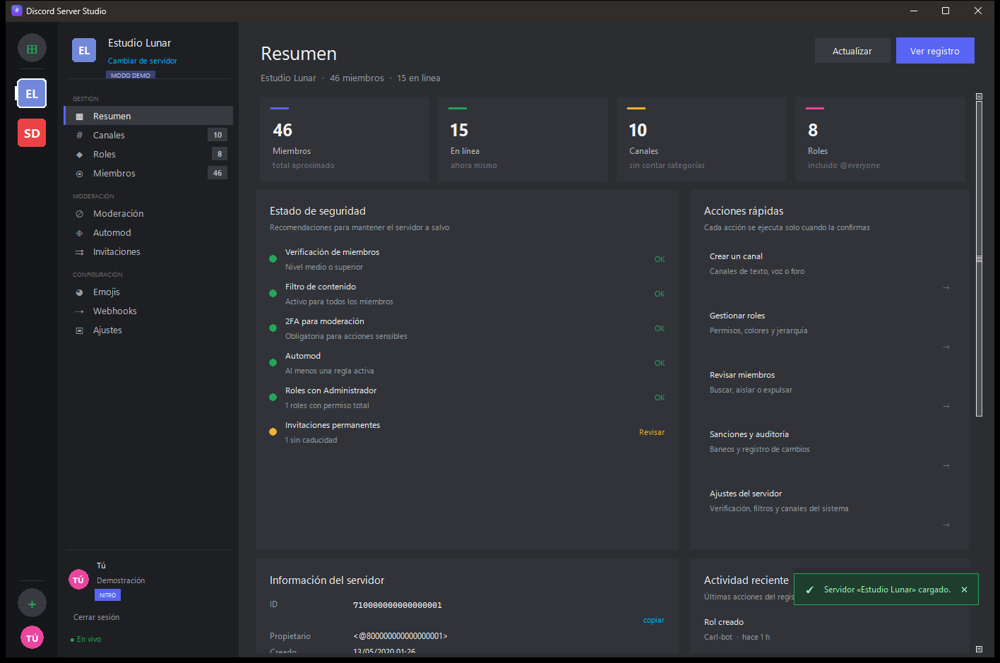

---

## Índice

1. [Características](#características)
2. [Capturas](#capturas)
3. [Requisitos](#requisitos)
4. [Inicio rápido](#inicio-rápido)
5. [Cómo iniciar sesión con OAuth2](#cómo-iniciar-sesión-con-oauth2)
6. [Qué servidores verás](#qué-servidores-verás)
7. [Módulos](#módulos)
8. [Permisos y ejecución](#permisos-y-ejecución)
9. [Seguridad y privacidad](#seguridad-y-privacidad)
10. [Atajos de teclado](#atajos-de-teclado)
11. [Modo demostración](#modo-demostración)
12. [Estructura del proyecto](#estructura-del-proyecto)
13. [Empaquetar como ejecutable](#empaquetar-como-ejecutable)
14. [Pruebas y herramientas](#pruebas-y-herramientas)
15. [Limitaciones conocidas](#limitaciones-conocidas)
16. [Aviso importante sobre los Términos de Servicio](#aviso-importante-sobre-los-términos-de-servicio)
17. [Licencia](#licencia)

---

## Características

- **Acceso con OAuth2 de Discord**: botón **Continuar con Discord**, sin contraseña ni usuarios
  internos. El canje del código usa **PKCE**, así que el client secret no se necesita ni se
  guarda. Las acciones las ejecuta un bot que tú invitas.
- **Avatares e iconos reales**: descarga en segundo plano el avatar de tu cuenta y los iconos
  de los servidores desde el CDN de Discord. Si un servidor no tiene icono (o falla la red),
  se dibuja el respaldo con iniciales; en cuanto llega la imagen se sustituye sola.
- **Multi-servidor solo de administración**: lista de servidores al entrar con **únicamente**
  aquellos donde eres propietario o tienes permisos administrativos. Los servidores donde solo
  eres miembro o moderador sin administración **no aparecen**. Cambiar de servidor recarga
  canales, roles, miembros y permisos.
- **Bot por servidor**: la tarjeta indica si falta el bot y ofrece un enlace de invitación con
  el `guild_id` ya rellenado; al volver, **Actualizar** detecta la instalación.
- **10 módulos de administración**: resumen, canales, roles, miembros, moderación
  (sanciones, auditoría y mensajes), automod, invitaciones, emojis, webhooks y ajustes.
- **Roles masivos por JSON**: en **Roles → Gestionar roles masivos** puedes pegar o cargar un
  archivo JSON con `roles` (crear, modificar, eliminar, posición, icono, permisos grant/revoke)
  y miembros (asignar o quitar), previsualizar cada operación y ejecutarla con progreso y estado.
- **Generar JSON**: instantánea no ejecutable de todos los roles con sus miembros, permisos e
  iconos; se muestra en el editor y en la tabla, permite quitar filas locales y se puede
  **copiar** o **exportar** a un archivo. No se puede cargar ni modificar en Discord.
- **Pegar JSON**: botón junto a **Cargar archivo** que valida el portapapeles; si no es un objeto
  JSON válido no reemplaza el editor y avisa.
- **Selección y borrado en el editor**: clic, `Shift+clic` (rango; quita si ya estaba),
  `Shift+arrastrar` (bloque dinámico), `Ctrl+clic/arrastrar` (filas sueltas),
  `Shift+↑/↓` y `Shift+PageUp/PageDown`; `Supr` o clic derecho → **Eliminar rol(es) del JSON**
  quita todas las operaciones seleccionadas del editor y de la tabla, sin tocar Discord.
- **Emojis por pestañas**: **Emojis** (subir primero, cuadrícula con vista previa
  estática/animada) y **Gestionar emojis masivo** (JSON con `create`/`update`/`delete`,
  imágenes por URL, ruta o base64, roles y progreso). El contador y el nivel de mejoras quedan
  encima de las pestañas; el modal de subida previsualiza PNG/JPG/GIF/WebP, animando GIF/WebP.
- **Editor de rol por pestañas**: **Visualizar** (nombre, color, icono con Nivel 2), **Permisos**,
  **Enlaces** (rol vinculado, con las condiciones de Discord) y **Miembros (N)** para asignar o
  quitar el rol.
- **Reordenar roles arrastrando**: si tu cuenta tiene **Gestionar roles**, arrastra un rol de la
  lista para cambiar su posición; también sirven las flechas. Discord exige que el rol del bot
  esté por encima de los roles que mueves. Los roles de bots (`Honeypot`, `Gestores`…) y
  `@everyone` no se editan desde el panel.
- **Diseño adaptable**: el editor de roles desplaza su contenido y deja fijo el pie con
  **Eliminar / mover / Guardar**, para que los botones no se corten al reducir la ventana; la
  tabla de roles masivos tiene desplazamiento horizontal.
- **Permisos reales**: la app calcula los permisos de **tu cuenta** (roles + `@everyone`) y
  deshabilita lo que no puedes hacer, explicando qué permiso falta. El bot necesita permisos
  equivalentes para ejecutar la acción.
- **Nombres de canal normalizados**: al crear o editar, minúsculas, espacios a guiones y solo
  letras, números y guiones (los acentos se eliminan).
- **Selector de emojis**: estándar, del servidor (animados incluidos) y recientes, para
  insertarlos en el tema de un canal, en los mensajes y en los MD.
- **Capacidades reales**: distingue cuenta con **Nitro** o sin él, servidor con **comunidad
  activa** o sin ella, y **nivel de mejoras** (0-3) para habilitar o bloquear opciones y
  mostrar los límites que Discord aplica.
- **Actualización manual**: el sondeo automático está **desactivado por defecto**; usa
  **Actualizar** (en la barra lateral, en todas las páginas) o `F5`. `Ver registro` también
  está siempre disponible y abre la auditoría.
- **Sincronización tras cambios**: al guardar, crear, eliminar o confirmar una acción, la app
  vuelve a leer el servidor y la página, incluyendo cambios hechos por terceros en Discord.
  Si descartas un cambio local, pulsa **Actualizar** para recoger también lo externo.
- **Confirmaciones seguras** para acciones destructivas, con texto que hay que escribir
  (por ejemplo, el nombre del canal o del servidor).
- **Motivos de auditoría**: las acciones de moderación aceptan un motivo que Discord guarda
  en el registro de auditoría.
- **Tema oscuro nativo**, tablas ordenables, búsquedas, paginación de miembros y auditoría.
- **Credenciales cifradas** con DPAPI (Windows), Llavero (macOS) o libsecret (Linux): tokens
  OAuth y token del bot. Sin client secret en el código.
- **Sin Electron ni navegador**: Python 3.10+, Tkinter y **Pillow** (para vista previa de
  JPG/WebP y animaciones GIF/WebP). No hay servidor web ni entorno Node.
- **Modo demostración** con tres servidores inventados (dos visibles y uno oculto sin permisos)
  para probarlo todo sin token.

## Capturas

| Inicio de sesión | Selector de servidor |
|---|---|
| 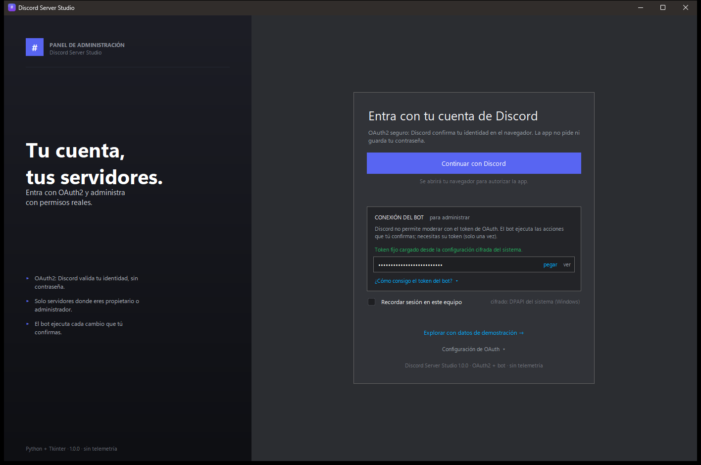 | 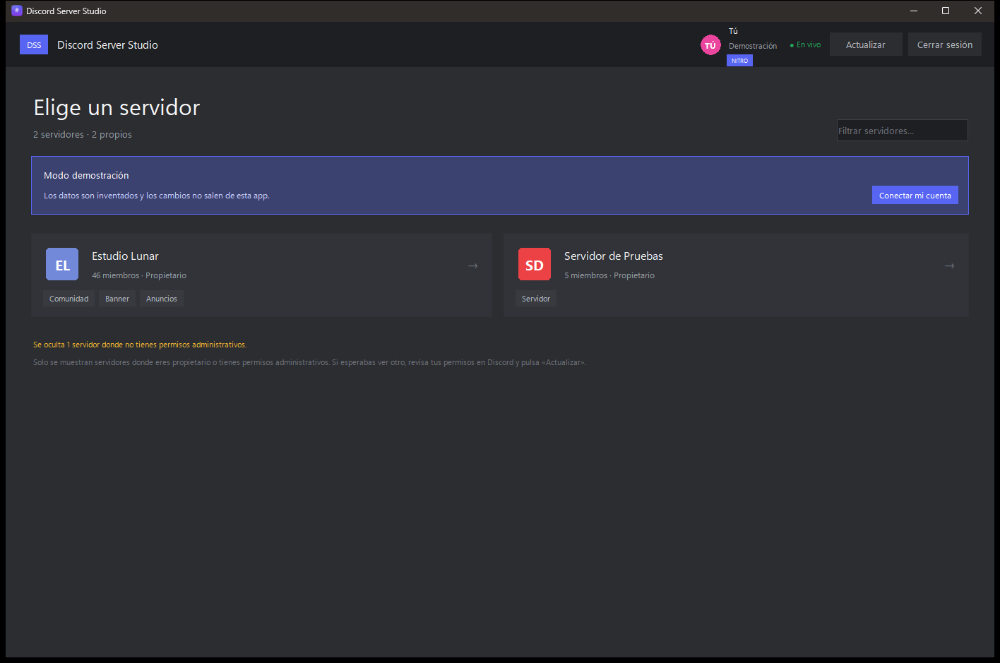 |

| Canales | Roles |
|---|---|
| 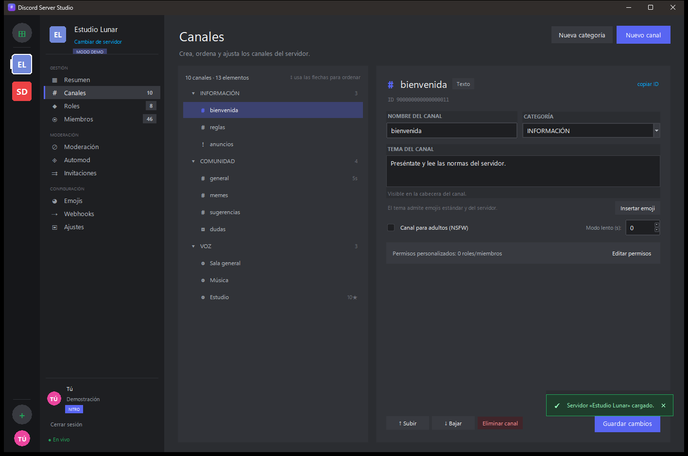 | 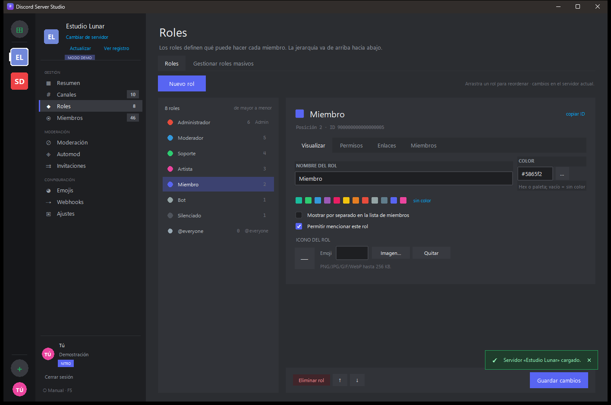 |

| Roles masivos (JSON) | Roles en ventana pequeña |
|---|---|
| 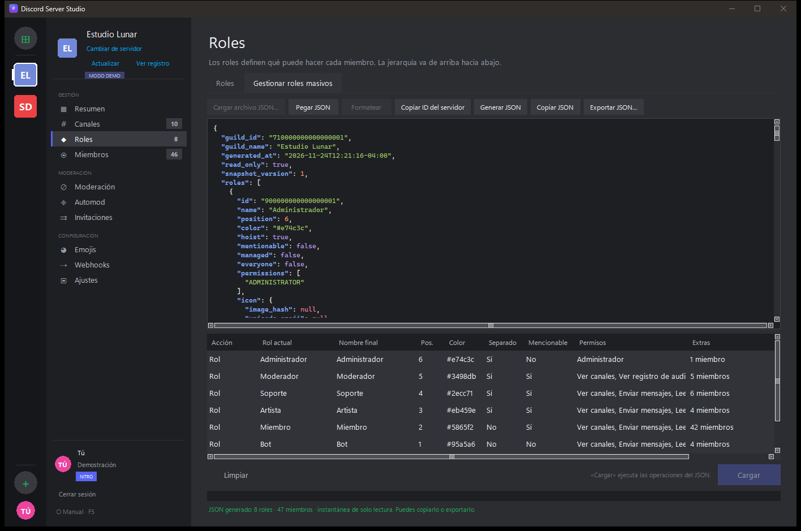 | 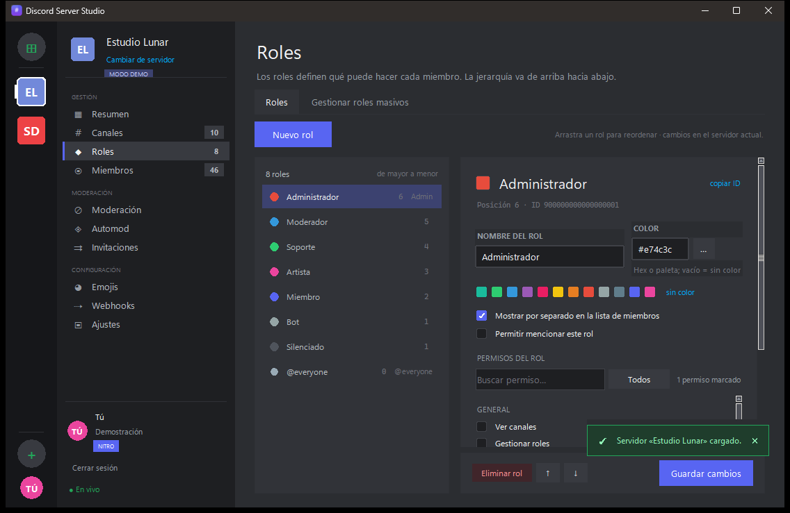 |

| Moderación | Automod |
|---|---|
| 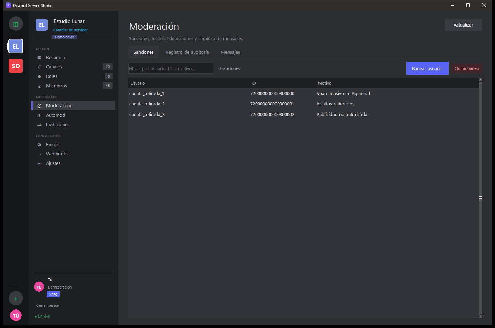 | 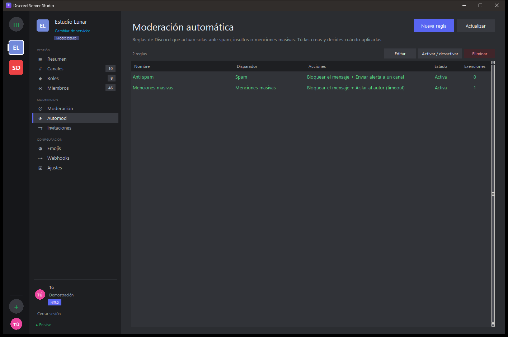 |

| Selector de emojis | Emojis del servidor |
|---|---|
| 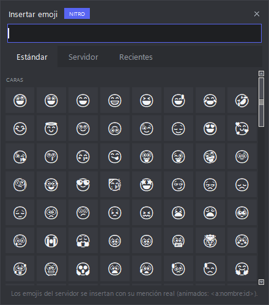 | 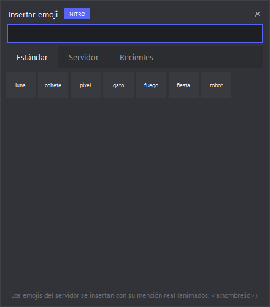 |

| Beneficios del servidor | Comunidad activa |
|---|---|
| 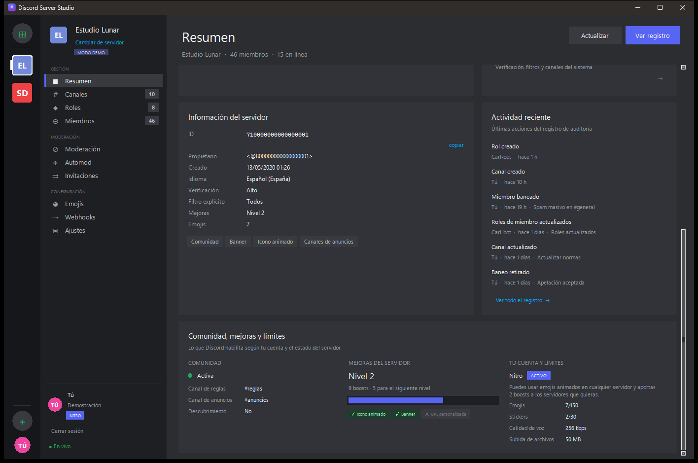 | 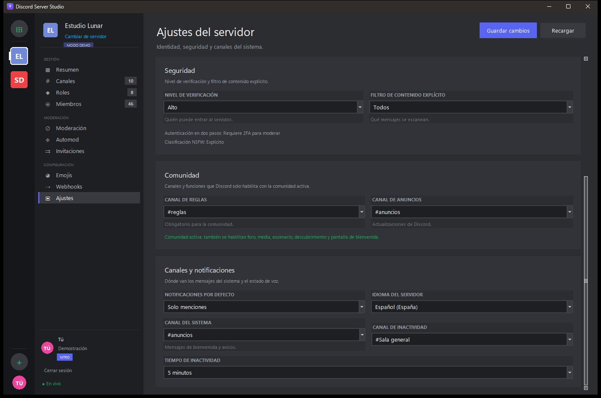 |

Más capturas en [`capturas/`](capturas): miembros, registro de auditoría, mensajes,
invitaciones, emojis, webhooks, ajustes y diálogos.

> Las capturas de canales, roles, moderación, automod, etc. usan datos de demostración para
> que no aparezcan datos privados; con OAuth + bot los mismos módulos funcionan en servidores
> reales.

## Requisitos

- **Python 3.10 o superior** con Tkinter.
  - Windows y macOS: la instalación oficial de Python incluye Tkinter.
  - Linux: `sudo apt install python3-tk` (Debian/Ubuntu) o el paquete equivalente.
- Conexión a internet (la app habla con `discord.com/api/v10`).
- `Pillow>=9` se instala con el paquete y solo se usa para previsualizar imágenes; la app
  funciona sin él con PNG/GIF estáticos.

## Inicio rápido

```bash
git clone <este-repositorio>
cd configurar-server-discord

python main.py            # abre la ventana de inicio de sesión
python main.py --demo     # entra con datos inventados, sin token
```

En Windows también puedes hacer doble clic en **`iniciar.bat`**; en macOS/Linux,
`./iniciar.sh`.

## Cómo iniciar sesión con OAuth2

El acceso es **con OAuth2** para la cuenta y un **token de bot** para ejecutar las acciones:
no se pide contraseña ni el token de sesión de la cuenta. La app abre el navegador, Discord
confirma tu identidad y vuelve a la app mediante un callback local.

1. En <https://discord.com/developers/applications> abre tu aplicación.
2. En **OAuth2 → Redirects** añade **exactamente** `http://127.0.0.1:5000/callback` (o el
   redirect que configures en la app).
3. En **Bot → Reset Token** copia el **token del bot**.
4. En **Bot → Privileged Gateway Intents** activa **Server Members Intent** (la app lo necesita
   para listar miembros y calcular sus roles).
5. En la app pega ese token en **Conexión del bot** y pulsa **Continuar con Discord**.
6. Autoriza la app en el navegador. Volverás automáticamente al selector de servidores.
7. Si el bot no está en un servidor, la tarjeta lo indica como **falta el bot**; al abrirla
   tendrás un enlace de invitación con ese servidor ya seleccionado. Después pulsa
   **Actualizar**.

El token del bot queda **fijo y cifrado** en la configuración del sistema (`bot_token.dat`,
DPAPI/Llavero/libsecret). En los siguientes arranques aparece ya relleno: solo tienes que
autorizar OAuth. Si reseteas el token en el portal, pégalo una vez en la app para actualizarlo.

El **client secret no se usa ni se guarda**: el canje del código se hace con PKCE y solo se
necesita el Client ID. Si alguna vez compartiste el secret, rótalo en **OAuth2 → Reset Secret**;
la app seguirá funcionando.

### Por qué hace falta el bot

Discord distingue dos credenciales:

- **OAuth2 de usuario** (`identify guilds`): sirve para saber quién eres y listar tus servidores
  con tus permisos. **No** sirve para `PATCH`/`POST`/`DELETE` de canales, roles, miembros,
  mensajes ni ajustes; la API responde `401/403`.
- **Token de bot**: es la identidad de aplicación que Discord sí acepta para administrar. Debe
  estar invitada al servidor y tener los permisos necesarios.

La app usa las dos: tu cuenta decide **qué ves y qué botones se habilitan**; el bot ejecuta la
acción que confirmas. Es el modo que Discord admite para herramientas externas (no es un
self-bot). Los mensajes que envíes y las acciones de moderación aparecerán **como el bot** en
Discord y en la auditoría, no como tu cuenta.

### Configuración de OAuth

En **Configuración de OAuth** (dentro del login) puedes cambiar el **Client ID** y el
**Redirect URI**. El redirect debe coincidir carácter por carácter con el registrado en el
portal. Si usas `http://127.0.0.1/callback` (sin puerto), la app escuchará en el puerto 80;
si usas `http://127.0.0.1:5000/callback`, en el 5000. El Client ID por defecto es el de la app
incluida; cámbialo si usas otra aplicación.

## Qué servidores verás

La app consulta `GET /users/@me/guilds` con el **token OAuth de tu cuenta**, que devuelve los
servidores donde eres miembro y **tus** permisos en cada uno. Solo se muestran los servidores
donde la cuenta:

- es **propietaria** del servidor, o
- tiene **permisos administrativos**: `ADMINISTRADOR` o `GESTIONAR SERVIDOR`.

Todo lo demás se oculta: no aparece en el selector ni en la barra lateral, y no se puede abrir
aunque se conozca el ID. Si la cuenta es solo miembro, o moderadora sin administración, ese
servidor no se lista. El selector indica cuántos servidores se ocultaron por no tener permisos.

Cada tarjeta muestra el nivel de acceso (**Propietario** o **Administrador**) y los servidores
propios aparecen primero. Si esperabas ver un servidor, revisa tus permisos en Discord y pulsa
**Actualizar**.

El bot puede estar en el servidor o no: si no está, la tarjeta lo marca como **falta el bot** y
ofrece el enlace de invitación. Que el bot esté dentro no cambia qué servidores ves: eso lo
deciden **tus** permisos OAuth.

## Módulos

| Módulo | Qué permite hacer |
|---|---|
| **Resumen** | Estado del servidor, contadores, checklist de seguridad, **tarjeta de comunidad/mejoras/límites**, información y actividad reciente. |
| **Canales** | Crear/editar/borrar canales de texto, voz, anuncios, foro, media y escenario (los cuatro últimos solo con comunidad); categorías; tema, NSFW, modo lento, límite de voz y calidad de audio según el nivel de mejoras; reordenar; permisos por rol; nombres normalizados. |
| **Roles** | Crear/editar/borrar roles; nombre, color (paleta o selector), mostrar por separado, mencionable; los 49 permisos agrupados y buscables; jerarquía con **arrastrar y soltar** o flechas; `@everyone` protegido; los roles gestionados por apps (bot roles) se muestran en **solo lectura**; pestaña **Gestionar roles masivos** para crear, modificar, reordenar, ver permisos, eliminar o asignar/quitar roles a miembros desde JSON. |
| **Miembros** | Buscar y paginar; filtrar humanos/bots/aislados/pendientes; asignar roles; apodo; aislamiento temporal (timeout) con presets; expulsar; banear; enviar mensaje directo con selector de emojis. |
| **Moderación** | **Sanciones**: lista de baneos, banear con borrado de mensajes, quitar baneo. **Registro**: auditoría filtrable por categoría y moderador, detalle de cambios. **Mensajes**: cargar últimos 50, borrar seleccionados (lote o uno a uno si son antiguos), fijar/desfijar, enviar mensajes y selector de emojis. |
| **Automod** | Crear y editar reglas de moderación automática de Discord: palabras clave, spam, listas predefinidas, menciones masivas y perfil de miembro; acciones de bloqueo, alerta, timeout; activar/desactivar y borrar. |
| **Invitaciones** | Listar, crear (usos, duración, solo nuevos), copiar y revocar enlaces. |
| **Emojis** | Listar con vista previa, subir (PNG/JPG/GIF ≤ 256 KB) y eliminar; muestra los espacios usados sobre el límite del nivel de mejoras y bloquea la subida al alcanzarlo. |
| **Webhooks** | Listar, crear por canal, copiar URL y eliminar. |
| **Ajustes** | Nombre, descripción, icono y banner (el banner requiere Nivel 2; el icono GIF, Nivel 1); verificación, filtro, notificaciones, idioma, canales del sistema/inactividad; sección **Comunidad** solo si está activa; **quitar el bot** del servidor (tu cuenta permanece). |

## Roles masivos por JSON

En **Roles → Gestionar roles masivos** puedes pegar el JSON directamente o cargarlo desde un
archivo `.json`. El editor lo muestra **indentado y coloreado** (claves azules, textos verdes,
números naranjas, booleanos violetas). Debajo se previsualiza cada operación en una tabla y al
final están **Limpiar** y **Cargar**, con barra de progreso y estado.

```json
{
  "guild_id": "123456789012345678",
  "roles": {
    "create": [
      {
        "name": "VIP",
        "position": 10,
        "color": "#F1C40F",
        "hoist": true,
        "mentionable": true,
        "icon": {"image_base64": null, "unicode_emoji": "⚔️"},
        "permissions": {
          "grant": ["SendMessages", "AttachFiles"],
          "revoke": ["Administrator"]
        },
        "links": {"is_linked_role": false, "requirements": []},
        "members": {"add": ["111222333444555666"], "remove": []}
      }
    ],
    "modify": [
      {
        "id": "987654321098765432",
        "name": "Moderador General",
        "position": 8,
        "permissions": {"grant": ["ManageMessages"], "revoke": ["ManageGuild"]}
      }
    ],
    "delete": [
      {"id": "112233445566778899", "reason": "Rol obsoleto"}
    ]
  },
  "role_members": [
    {"role_id": "987654321098765432", "add_users": [], "remove_users": ["999888777666555444"]}
  ]
}
```

- **roles.create**: `name` obligatorio; `position`, `color`, `hoist`, `mentionable`, `icon`,
  `permissions`, `links` y `members`.
- **roles.modify**: `id` o `target_name`; solo se envían los campos indicados; `position` se
  aplica después de actualizar.
- **roles.delete**: `id` o `target_name`; `reason` opcional.
- **roles.view** (o `permissions`): solo muestra los permisos actuales; no modifica nada.
- **icon**: `image_base64` (data URI PNG/JPG/GIF/WebP) o `unicode_emoji`; requiere **Nivel 2**
  de mejoras del servidor y **Gestionar roles**. No se pueden usar ambos.
- **permissions**: objeto con `grant` y `revoke` (relativo a los permisos actuales); también se
  acepta una lista o un número para reemplazarlos.
- **members**: `add`/`remove` con IDs de usuario; se aplican después de crear o modificar el rol.
- **links**: requisitos de rol vinculado. Discord **no permite aplicarlos por API**: se validan y
  se muestran como “enlaces manuales”; configúralos en **Discord → Ajustes del servidor → Roles
  → Enlaces**. Solo se pueden añadir si el rol no tiene miembros.
- **role_members**: formato alternativo en la raíz; `role_id`/`target_name` + `add_users` y
  `remove_users`.
- **position** debe ser un entero mayor que 0. Discord exige que el rol del bot esté por encima
  de la posición solicitada.
- **guild_id** es opcional; si se indica, debe coincidir con el servidor abierto.
- El formato plano anterior (listas `create`/`modify`/`delete` en la raíz) sigue aceptándose,
  pero el recomendado es el anidado dentro de `roles`.
- **Pegar JSON**: valida el portapapeles antes de tocar el editor. Si no es un objeto JSON
  válido no pega nada y muestra el motivo; si es válido, **reemplaza todo** el contenido actual.
- **Copiar JSON**: se habilita cuando hay un JSON válido en el editor o cuando se generó una
  instantánea.
- **Seleccionar una o varias filas**: clic normal; **Shift+clic** selecciona un rango y, si la
  fila ya estaba seleccionada, la deselecciona; **Shift+arrastrar** selecciona o deselecciona un
  bloque contiguo en tiempo real; **Ctrl+clic/Ctrl+arrastrar** alterna filas sueltas; y
  **Shift+↑/↓** o **Shift+PageUp/PageDown** extienden o reducen el rango. La primera fila
  seleccionada se resalta en el JSON; con varias se muestra el contador.
- **Supr** o clic derecho → **Eliminar rol/roles del JSON** quita **todas las operaciones
  seleccionadas** del editor y de la tabla; no borra nada en Discord. En una instantánea generada
  también puedes quitar filas: se actualiza el JSON local, pero **Cargar** sigue bloqueado.
- **Ver errores (N)**: si la previsualización tiene operaciones inválidas, el botón abre el
  detalle con la ruta exacta (`roles.modify[4]`, `role_members[2]`…), la acción, el rol y el
  motivo. Los errores de sintaxis JSON muestran línea y columna.
- **Generar JSON no ejecutable**: junto a **Copiar ID del servidor**, el botón
  **Generar JSON** vuelve a leer los roles y sus miembros, permisos, iconos y estado de enlaces,
  los muestra en el editor como instantánea y **rellena la tabla con un rol por fila**. El editor
  solo permite quitar filas locales; **Cargar** se desactiva y **Exportar JSON…** guarda el
  resultado. Es solo estructura: no crea, edita, revoca ni elimina nada en Discord.
- Las operaciones se ejecutan **en orden**; si una falla, se detiene y muestra el error. Los
  cambios ya aplicados se refrescan en la app.
- `Cargar` ejecuta el JSON; `Cargar archivo JSON…` lo lee de disco; `Formatear` lo reindenta;
  `Limpiar` vacía el editor, la tabla y el estado. Al seleccionar una fila se muestran todos sus
  permisos en la barra de estado.

### Pestañas del editor de rol

Al seleccionar un rol, debajo de su nombre e ID hay cuatro pestañas:

- **Visualizar**: nombre, color, paleta, mostrar por separado, mencionable e **icono**. El icono
  se habilita solo con **Nivel 2** de mejoras y permite imagen o emoji. No muestra permisos.
- **Permisos**: los 49 permisos, con búsqueda y Ninguno/Todos.
- **Enlaces**: estado y condiciones de los roles vinculados; se configuran en Discord porque la
  API no permite escribir los requisitos.
- **Miembros (N)**: miembros que tienen el rol; al abrirla se carga el contador y se pueden
  añadir por ID o quitar. Respeta la jerarquía del bot y `@everyone`.

El pie con **Eliminar / mover / Guardar** sigue fijo y el contenido se desplaza si la ventana es
pequeña.

### Error 50001 al ver miembros o generar JSON

No es un permiso del rol ni hace falta ser administrador. Discord exige la opción privilegiada
**Server Members Intent** para que un bot pueda leer la lista de miembros:

1. Entra en el **Portal de Desarrolladores de Discord** → tu aplicación → **Bot**.
2. En **Privileged Gateway Intents**, activa **Server Members Intent**.
3. Pulsa **Save Changes** y reinicia la app. No hace falta volver a invitar el bot.
4. Si el bot está en más de 100 servidores, Discord puede pedir verificación de la app.

Sin esa opción, `GET /guilds/{id}/members` devuelve `50001 Missing Access`, aunque el bot tenga
todos los permisos del servidor. Afecta a **Miembros (N)** y a **Generar JSON**.

### Error 50013 al cargar roles

El JSON es válido. Discord devuelve `50013` cuando el **bot** no puede completar la operación:

- Para crear o modificar un rol con `"permissions": ["Administrator"]`, el bot también necesita
  **Administrador**. No basta con «Gestionar roles».
- El rol más alto del bot debe estar **por encima** de los roles que crea, modifica o elimina.
  Si el bot está al final de la jerarquía, súbelo (o dale Administrador y súbelo igualmente).
- El rol del bot (`Gestores`) es gestionado por la app y **no se puede editar desde el panel**;
  dale Administrador y muévelo en **Ajustes del servidor → Roles** de Discord.
- La invitación del bot ya incluye Administrador. Si el bot ya estaba en el servidor, edita su
  rol en **Ajustes del servidor → Roles** o vuelve a invitarlo con el enlace de la app.
- El lote se detiene en la primera operación que falla; las anteriores ya aplicadas permanecen.
  Corrige el permiso y vuelve a cargar el mismo JSON.
- Lo mismo se aplica al **reordenar arrastrando**: si el rol del bot está por debajo del rol que
  mueves, Discord devuelve `50013`. Sube el rol del bot en Discord antes de reordenar.

## Emojis masivos por JSON

La pestaña **Gestionar emojis masivo** acepta:

```json
{
  "guildId": "123456789012345678",
  "emojis": [
    {"action": "create", "name": "desde_url", "image": "https://ejemplo.com/a.gif", "roles": []},
    {"action": "create", "name": "desde_ruta", "image": "./imagenes/a.png", "roles": ["987654321098765432"]},
    {"action": "create", "name": "desde_base64", "image": "data:image/png;base64,...", "roles": []},
    {"action": "update", "emojiId": "111222333444555666", "name": "nuevo_nombre", "roles": []},
    {"action": "delete", "emojiId": "777888999000111222"}
  ]
}
```

- **create**: nombre (1–32 letras/números/_), imagen por URL, ruta local o data URI, y roles.
- **update**: `emojiId` y cambios de nombre/roles; Discord no permite cambiar la imagen.
- **delete**: `emojiId`.
- Las imágenes se descargan/leen y se validan (máx. 256 KB) antes de subirlas.
- El límite de emojis se calcula con el nivel de mejoras del servidor.
- **Generar JSON** produce una instantánea con los emojis actuales (`readOnly`); se puede copiar o
  exportar y no se ejecuta.

## Permisos y ejecución

La app no intenta saltarse los permisos de Discord: los respeta y los refleja.

- Con **Administrador** en el servidor se habilita todo.
- Si no lo tienes, cada botón comprueba el permiso necesario y aparece **deshabilitado** con
  una franja de aviso («Solo lectura: falta el permiso …»).
- El **bot** ejecuta la acción: necesita estar invitado, tener el permiso y que su rol esté
  **por encima** del rol que intenta gestionar. Discord devolverá `403`/`50013` si algo no es
  posible; la app traduce el error a un mensaje claro.
- Los **roles gestionados por apps** (los roles de bots, como `Gestores`, `Honeypot`, `Dyno`…)
  son de **solo lectura** en el panel: el bot no puede editar su propio rol gestionado y Discord
  lo rechaza. Edítalos en **Ajustes del servidor → Roles** de Discord, o crea un rol normal con
  **Nuevo rol** / usa `@everyone` para permisos propios.
- Si tu cuenta puede pero el bot no, verás el error de Discord y el diálogo de invitación
  cuando falte el bot.

### Nombres de canal

- **Todos los canales** aceptan **emojis Unicode** en el nombre.
- **Categorías** y canales de **voz/escenario**: conservan mayúsculas, espacios, signos y emojis.
- **Texto, foro y anuncios**: minúsculas, espacios a `-`, se quitan acentos/símbolos no emoji
  y se conservan letras, números, guiones y emojis.
- **Anuncios y foros** requieren **Comunidad** activa; sin ella solo se ofrecen texto y voz.
- El nombre se normaliza al crear o guardar, tanto en el editor como en el JSON masivo.

### Selector de emojis

El botón **Insertar emoji** (tema del canal, compositor de mensajes y mensajes directos) abre
un selector con:

- **Estándar**: emojis Unicode agrupados por categorías, con búsqueda por nombre.
- **Servidor**: emojis personalizados del servidor, incluidos los animados; se insertan con su
  mención real (`<:nombre:id>` o `<a:nombre:id>`).
- **Recientes**: los últimos que usaste.

Tkinter dibuja los emojis del selector en blanco y negro (limitación de Tk); al enviarlos,
Discord los muestra a color. La cabecera indica si tu cuenta tiene **NITRO** o no.

### Nitro, comunidad y mejoras

La app lee el estado real de la cuenta y del servidor y adapta la interfaz; no inventa
beneficios que Discord no conceda.

**Nitro de la cuenta** (`premium_type`): insignia **NITRO** en la barra lateral, el selector de
servidores y el selector de emojis. Con Nitro puedes usar emojis animados en cualquier
servidor y aportas 2 boosts donde quieras; sin Nitro, los animados solo se ven dentro del
servidor donde están subidos. La app no muestra opciones de Nitro que no puedas usar.

**Comunidad activa** (`COMMUNITY` en `features`):

- habilita al crear canales los tipos **Anuncios, Foro, Media y Escenario** (sin comunidad
  solo aparecen Texto y Voz);
- muestra en Ajustes los canales de **reglas** y **anuncios** del servidor;
- indica descubrimiento y pantalla de bienvenida en el resumen.

Si no está activa, Ajustes muestra un aviso con los pasos para activarla desde Discord y no
envía campos que la API rechazaría.

**Mejoras del servidor** (`premium_tier` y `premium_subscription_count`): la tarjeta del
resumen muestra el nivel, los boosts actuales, cuántos faltan para el siguiente nivel y los
beneficios desbloqueados.

| Nivel | Emojis | Stickers | Voz | Subida | Extras |
|---|---|---|---|---|---|
| 0 | 50 | 5 | 96 kbps | 25 MB | — |
| 1 | 100 | 15 | 128 kbps | 25 MB | icono animado |
| 2 | 150 | 30 | 256 kbps | 50 MB | banner |
| 3 | 250 | 60 | 384 kbps | 100 MB | URL personalizada |

La app bloquea el banner si el servidor no es Nivel 2, avisa si intentas subir un icono GIF sin
Nivel 1, limita la calidad de voz al máximo del nivel y muestra los espacios de emoji
usados/totales (bloqueando la subida al llegar al límite).

## Seguridad y privacidad

- **Cifrado en reposo**: los tokens OAuth (access + refresh) y el token fijo del bot se guardan
  por separado con DPAPI (Windows), el Llavero de macOS o libsecret (Linux). Si no hay ningún
  almacén disponible, se avisa en la interfaz y se usa un archivo con permisos `0600`.
- **Token fijo del bot**: se guarda en `bot_token.dat` y se carga al abrir la app; el login lo
  muestra relleno. **Cerrar sesión** borra solo el token OAuth y conserva el del bot. Para
  olvidarlo, borra `bot_token.dat` o cambia el token por otro.
- **PKCE, sin client secret**: el login genera un `code_verifier`/`code_challenge` y canjea el
  código sin el secret de la aplicación. El secret no se escribe en el código ni en disco.
- **Permisos mínimos de OAuth**: solo se piden `identify` y `guilds`; no se piden `email`,
  `connections`, `rpc.*` ni permisos de bot en la pantalla de login.
- **El bot es aparte**: su token se usa solo para las acciones que confirmas; no se usa como
  login ni se muestra en la interfaz.
- **Sin contraseña**: la app nunca solicita ni almacena tu email o contraseña de Discord.
- **Sin telemetría**: solo habla con `discord.com` (API y OAuth) y
  `cdn.discordapp.com` (iconos y emojis). No envía datos a ningún servidor propio.
- **Nada se registra**: los tokens no se escriben en logs ni en la auditoría.
- **Datos locales**: ajustes y sesión en
  - Windows: `%APPDATA%\DiscordServerStudio`
  - macOS: `~/Library/Application Support/DiscordServerStudio`
  - Linux: `~/.config/DiscordServerStudio`
- **Modo portable**: define `DSS_HOME` para guardar todo en una carpeta concreta:
  ```bash
  DSS_HOME=./datos python main.py          # Linux/macOS
  set DSS_HOME=.\datos && python main.py   # Windows (cmd)
  ```
- **Cerrar sesión** borra el token OAuth y desactiva el recuerdo; el token fijo del bot se
  conserva para el siguiente acceso. Puedes revocarlo en **Bot → Reset Token** y pegar el nuevo.

## Atajos de teclado

| Atajo | Acción |
|---|---|
| `F5` | Actualizar la lista de servidores |
| `Ctrl+1` … `Ctrl+9` | Solo en modo demostración: módulos |
| `Ctrl+Shift+S` | Volver al selector de servidores |
| `Ctrl+Q` | Salir |

## Modo demostración

`python main.py --demo` (o el enlace **Explorar con datos de demostración** del login) abre
tres servidores inventados con canales, roles, 47 miembros, sanciones, auditoría, emojis,
webhooks y reglas de automod. Todas las acciones funcionan en memoria para que puedas probar
el flujo completo sin tocar ningún servidor real.

## Actualización manual

El sondeo automático está **desactivado por defecto** para no interrumpir lo que estás editando.

- **Actualizar** está en la barra lateral y funciona en cualquier página: vuelve a leer la lista
  de servidores, el guild, canales, tu ficha y la página visible.
- **Ver registro** está también en la barra lateral y abre **Moderación → Registro de auditoría**
  desde cualquier pantalla.
- `F5` equivale a **Actualizar**.
- Después de guardar, crear, eliminar o confirmar una acción, la app vuelve a consultar Discord;
  así aparecen también los cambios de terceros.
- Al descartar o deshacer un cambio local no se escribe en Discord; pulsa **Actualizar** para
  recoger los cambios externos.
- Los formularios con cambios sin guardar no se pisan al actualizar manualmente.

La app no usa WebSocket; las lecturas respetan los rate limits.

## Estructura del proyecto

```
configurar-server-discord/
├── main.py                  # punto de entrada
├── iniciar.bat / iniciar.sh # lanzadores
├── dss/
│   ├── api.py               # una función por operación de Discord
│   ├── http.py              # transporte: rate limits 429, reintentos, errores
│   ├── errors.py            # errores traducidos a español
│   ├── models.py            # modelos ligeros (guild, canal, rol, miembro, …)
│   ├── constants.py         # permisos, tipos, acciones de auditoría, automod
│   ├── oauth.py             # OAuth2 PKCE + callback local + refresh
│   ├── store.py             # ajustes + sesión OAuth/bot cifrada
│   ├── tasks.py             # tareas en hilos que devuelven al hilo de Tk
│   ├── demo.py              # cliente de demostración con datos realistas
│   └── ui/
│       ├── app.py           # ventana principal, sesión, navegación
│       ├── theme.py         # paleta y estilos ttk
│       ├── widgets.py       # tablas, modales, toasts, checkboxes, tooltips
│       ├── login.py         # OAuth2 + configuración del bot
│       ├── picker.py        # selector de servidor (propios y administrados)
│       ├── shell.py         # barra de servidores + navegación lateral
│       ├── permissions.py   # editor de permisos y de overwrites
│       └── pages/           # un archivo por módulo (roles, bulk_roles, …)
├── tools/                   # pruebas y generación de capturas/icono (dev)
└── capturas/                # capturas de la aplicación
```

## Empaquetar como ejecutable

Con PyInstaller (compila **en cada sistema operativo**; no hay compilación cruzada):

```bash
pip install pyinstaller

# Windows
pyinstaller --noconfirm --windowed --name DiscordServerStudio ^
  --icon dss/ui/assets/app.ico ^
  --add-data "dss/ui/assets;dss/ui/assets" main.py

# macOS / Linux (separador ':' en --add-data)
pyinstaller --noconfirm --windowed --name DiscordServerStudio \
  --add-data "dss/ui/assets:dss/ui/assets" main.py
```

También puedes instalarlo como comando de consola:

```bash
pip install .
discord-server-studio
```

## Pruebas y herramientas

Las herramientas de `tools/` son opcionales y no forman parte del programa:

```bash
python tools/check_core.py       # modelos, DPAPI, rate-limit y error 401 real
python tools/check_oauth.py      # 19 comprobaciones de PKCE, callback y sesión cifrada
python tools/check_images.py     # 11 comprobaciones de descarga/dibujado de avatares e iconos
python tools/check_ui_flows.py   # 55 flujos de UI en modo demo (crear/editar/borrar)
python tools/check_live.py       # 11 comprobaciones del motor de sincronización (opcional)
python tools/shots.py            # capturas (requiere Pillow)
python tools/make_icon.py        # regenera el icono (requiere Pillow)
```

`check_core.py`, `check_oauth.py`, `check_images.py`, `check_ui_flows.py` y `check_live.py`
usan `DSS_HOME` para no mezclar datos de prueba con los tuyos.

## Limitaciones conocidas

- **El bot es obligatorio para administrar**: OAuth de usuario solo identifica y lista
  servidores. Si no pegas el token del bot o no lo invitas, podrás entrar pero no abrir los
  servidores (la app te da el enlace de invitación).
- **Invitación por servidor**: el bot debe estar en cada servidor que quieras administrar. La
  tarjeta lo marca como **falta el bot** y el diálogo permite invitarlo con ese `guild_id`.
- **Permisos del bot**: tu cuenta puede ver un botón que el bot no pueda ejecutar (por ejemplo,
  por jerarquía de roles). En ese caso Discord devuelve `403`/`50013` y la app lo explica.
- **Sin sondeo automático por defecto**: los cambios externos aparecen al guardar/confirmar una
  acción o al pulsar **Actualizar**/`F5`; no hay WebSocket ni refresco periódico invasivo.
- **Hilos/stickers**: se muestran, pero no se administran individualmente.
- **Voz**: no se mueven/silencian miembros conectados en tiempo real.
- **Borrado masivo**: Discord solo permite borrar en lote mensajes de menos de 14 días.
- **Auditoría**: 100 entradas por página; se pagina con «Cargar más».
- **Roles**: no se pueden gestionar roles por encima del rol más alto del bot.
- **Sesión OAuth**: el access token dura unos 7 días. La app no guarda el client secret, así
  que al caducar te pedirá volver a entrar con Discord; el token del bot se conserva y la app
  lo rellena sola.
- **Imágenes**: si un servidor no tiene icono o el CDN falla, se muestra el respaldo con
  iniciales; los GIF animados se dibujan en su primer fotograma (limitación de Tk).

## Aviso importante sobre los Términos de Servicio

Esta versión **no usa el token de sesión de tu cuenta** ni automatiza tu cuenta: entra con
**OAuth2** (scopes `identify guilds`) y las acciones las ejecuta un **bot** con su propio token,
que es el modo que Discord admite para aplicaciones. No es un self-bot.

Aun así, el token del bot es una credencial sensible: no lo compartas, no lo subas a Git y
revócalo si crees que se filtró. El bot debe cumplir las políticas de Discord y los permisos
que concedas son responsabilidad tuya. La app solo ejecuta las acciones que confirmas
manualmente; no escucha mensajes ni automatiza moderación por su cuenta.

El **client secret no se usa** (PKCE); si lo compartiste, rótalo en **OAuth2 → Reset Secret**.

Este proyecto no está afiliado, asociado ni respaldado por Discord Inc.

## Licencia

MIT. Consulta [`LICENSE`](LICENSE).
